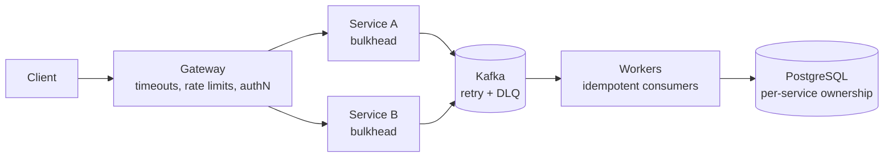

# Jelome

**System architect. Backend engineer.**

```text
$ cat about.txt
Designing backend systems where failure is a first-class concern.
If it can fail, I want to know how.
```

## Architecture

Most of my work follows one reference pattern: every boundary is treated as something that will fail, and the design says how.



## Projects

| | |
|---|---|
| **[Sitolo](https://github.com/jelome265/sitolo)**<br/>Business operating system for African SMEs. Offline-first, tenant-isolated, auditable inventory and payment workflows.<br/>`Rust` `PostgreSQL` `SQLite` `Flutter` `Tauri` | **[USORA](https://github.com/jelome265/USORA)**<br/>Multi-tenant KYC and identity verification. Document processing, biometric checks, risk scoring, and audit trails.<br/>`Rust` `Axum` `Java 21` `Spring Boot` `Kafka` `PostgreSQL` |
| **[Rustacean](https://github.com/jelome265/Rustacean)**<br/>Reusable Rust engineering workflows for AI coding agents, built around executable checks and CI and security automation.<br/>`Rust` `Python` `GitHub Actions` `CodeQL` | **[Nullwarden](https://github.com/jelome265/nullwarden)**<br/>Zero-knowledge password vault prototype. Local protection with cloud sync, a Rust CLI and core, and a REST backend.<br/>`Rust` `Axum` `PostgreSQL` |

## Engineering focus

- **Failure handling:** timeouts, retries with backoff, idempotency, circuit breakers, bulkheads, graceful degradation
- **Data ownership:** service-owned databases, consistency chosen per domain, versioned API and event contracts
- **Security:** OAuth2/OIDC, JWT, RBAC, least privilege, encryption at rest, supply-chain checks in CI
- **Observability:** OpenTelemetry, SLOs, alerting on symptoms users feel

## Stack

- **Primary:** Rust (Axum, Tokio, Cargo)
- **Enterprise:** Java 21, Spring Boot
- **Data and messaging:** PostgreSQL, Redis, Kafka, SQLite
- **Infrastructure:** Docker, Docker Compose, GitHub Actions, MinIO/S3

## Contact

[LinkedIn] · [email] · [blog]
