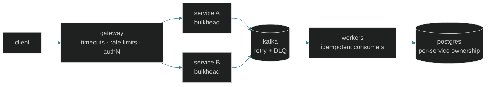

<!--
  DESIGN SYSTEM — "terminal noir"
  bg      #0B1218   surface  #0F1A22   line  #3a8296
  accent  #61DAFB   ice      #C8E1FF   warn  #FFB454
  Type: monospace for structure, sans for prose.
  Sections: "## [NN] TITLE". Tags: [PLATFORM] [TOOLING] [PROTOTYPE].
  Stats widgets reuse the palette above; keep them in sync.
-->

```text
     ██╗███████╗██╗      ██████╗ ███╗   ███╗███████╗
     ██║██╔════╝██║     ██╔═══██╗████╗ ████║██╔════╝
     ██║█████╗  ██║     ██║   ██║██╔████╔██║█████╗
██   ██║██╔══╝  ██║     ██║   ██║██║╚██╔╝██║██╔══╝
╚█████╔╝███████╗███████╗╚██████╔╝██║ ╚═╝ ██║███████╗
 ╚════╝ ╚══════╝╚══════╝ ╚═════╝ ╚═╝     ╚═╝╚══════╝
```

```text
  ┌─────────────────────────────────────────────────────────┐
  │ $ whoami                                                │
  │ system architect · backend engineer · rust-first        │
  │                                                         │
  │ > designing backend systems where failure is            │
  │   a first-class concern.                                │
  │ > if it can fail, i want to know how.                   │
  └─────────────────────────────────────────────────────────┘
```


---

## [01] ARCHITECTURE

Every boundary is assumed to fail. Each arrow below states its failure policy, and each store has one owner.



## [02] PROJECTS

| Project | Type | What it does | Stack |
|---|---|---|---|
| **[sitolo](https://github.com/jelome265/sitolo)** | `[PLATFORM]` | Business operating system for African SMEs. Procurement, inventory, pricing, sales, collections, payment reconciliation, reporting. Offline-first, tenant-isolated, auditable. | `rust` `postgres` `sqlite` `flutter` `tauri` |
| **[usora](https://github.com/jelome265/USORA)** | `[PLATFORM]` | Multi-tenant KYC and identity verification. Document processing, biometric checks, risk scoring, audit trails. | `rust` `axum` `java 21` `spring boot` `camunda` `kafka` `postgres` |
| **[rustacean](https://github.com/jelome265/Rustacean)** | `[TOOLING]` | Reusable Rust engineering workflows for AI coding agents. Executable checks, CI, security automation. | `rust` `python` `github actions` `codeql` |
| **[nullwarden](https://github.com/jelome265/nullwarden)** | `[PROTOTYPE]` | Zero-knowledge password vault. Local protection with cloud sync, a Rust CLI and core, a REST backend. | `rust` `axum` `postgres` `docker` |

## [03] PRINCIPLES

```text
▸ failure is designed, not discovered
    timeouts · backoff retries · idempotency · circuit breakers · bulkheads
▸ every piece of data has one owner
    service-owned databases · consistency chosen per domain
▸ contracts over coupling
    versioned apis and events, treated as public interfaces
▸ security is the default path
    oauth2/oidc · jwt · rbac · least privilege · encryption at rest · supply-chain checks
▸ observe what users feel
    opentelemetry · slos · alerts on symptoms, not noise
▸ split by domain, not by fashion
    no microservices unless the boundary earns them
```

## [04] STACK

```text
rust/      axum · tokio · cargo                  (primary)
java/      21 · spring boot · camunda            (enterprise)
data/      postgresql · redis · kafka · sqlite · minio/s3
infra/     docker · compose · github actions · codeql
clients/   flutter · tauri
```

## [05] TELEMETRY

```text
$ public repos ........ 15
$ upstream forks ...... credited to original authors
$ private work ........ not listed
```

<p align="center">
  
  
  
</p>

## [06] CONNECT

```text
  ✉  jelomengamuti@gmail.com
  in linkedin.com/in/jelome-ngamuti-a6a656281
```

[](https://www.linkedin.com/in/jelome-ngamuti-a6a656281)
[](mailto:jelomengamuti@gmail.com)

---

```text
░▒▓█ built to fail gracefully █▓▒░
```
