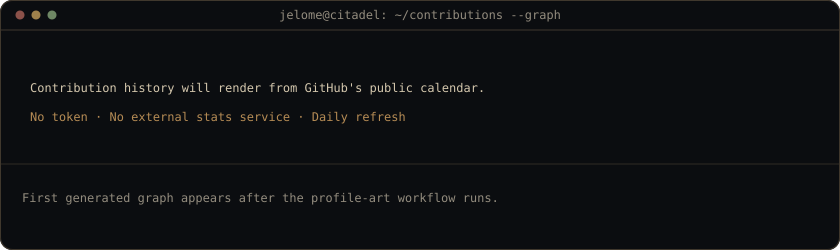
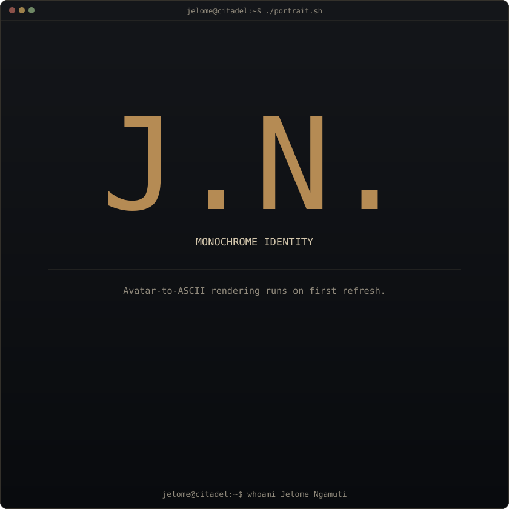

<!--
  Profile layout follows the animated SVG workflow described in the guide.
  Artwork is generated in this repository and refreshed with GitHub Actions.
-->

<h3><code>jelome265@github ~ $ ./contributions.sh</code></h3>

 
 

<h3><code>jelome265@github ~ $ whoami</code></h3>

<table>
  <tr>
    <td valign="top"></td>
    <td valign="top"></td>
  </tr>
</table>

 
 

<h3><code>jelome265@github ~ $ ./links.sh</code></h3>

<strong>Computer Science Student · Backend Engineering · Systems Design</strong>

  <a href="https://jelomengamuti.pages.dev">Portfolio</a>
  &nbsp;·&nbsp;
  <a href="https://www.linkedin.com/in/jelome-ngamuti-a6a656281">LinkedIn</a>
  &nbsp;·&nbsp;
  <a href="mailto:jelomengamuti@gmail.com">Email</a>

