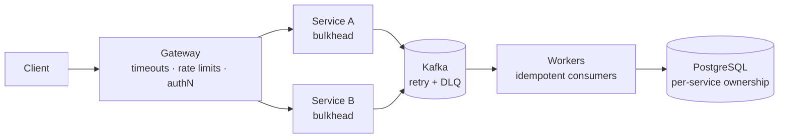

# JELOME

### System architect · Backend engineer · Rust-first

*Designing backend systems where failure is a first-class concern.*
*If it can fail, I want to know how.*

---

## Reference architecture

Every boundary is treated as something that will fail. The design states how it fails, how it recovers, and who owns the data.

## Featured projects

| Project | What it does | Stack |
|---|---|---|
| **[Sitolo](https://github.com/jelome265/sitolo)** | Business operating system for African SMEs. Connects procurement, inventory, pricing, sales, collections, payment reconciliation, and reporting. Offline-first, tenant-isolated, auditable. | `Rust` `PostgreSQL` `SQLite` `Flutter` `Tauri` |
| **[USORA](https://github.com/jelome265/USORA)** | Multi-tenant KYC and identity verification. Document processing, biometric checks, risk scoring, audit trails. | `Rust` `Axum` `Java 21` `Spring Boot` `Camunda` `Kafka` `PostgreSQL` |
| **[Rustacean](https://github.com/jelome265/Rustacean)** | Reusable Rust engineering workflows for AI coding agents, built on executable checks, CI, and security automation. | `Rust` `Python` `GitHub Actions` `CodeQL` |
| **[Nullwarden](https://github.com/jelome265/nullwarden)** | Zero-knowledge password vault prototype. Local protection with cloud sync, a Rust CLI and core, and a REST backend. | `Rust` `Axum` `PostgreSQL` `Docker` |

## Principles

- **Failure is designed, not discovered.** Timeouts, retries with backoff, idempotency, circuit breakers, bulkheads, graceful degradation.
- **Every piece of data has one owner.** Service-owned databases, consistency chosen per domain.
- **Contracts over coupling.** APIs and events are versioned and treated as public interfaces.
- **Security is the default path.** OAuth2/OIDC, JWT, RBAC, least privilege, encryption at rest, supply-chain checks in CI.
- **Observe what users feel.** OpenTelemetry, SLOs, alerts on symptoms rather than noise.
- **Split by business domain, not by fashion.** No microservices unless the boundary earns them.

## Stack

| Layer | Tools |
|---|---|
| **Primary** | Rust (Axum, Tokio, Cargo) |
| **Enterprise** | Java 21, Spring Boot, Camunda |
| **Data and messaging** | PostgreSQL, Redis, Kafka, SQLite, MinIO/S3 |
| **Infrastructure** | Docker, Docker Compose, GitHub Actions, CodeQL |
| **Clients** | Flutter, Tauri |

## GitHub stats

  
  
  

**Public portfolio:** 15 repositories. Forks of upstream projects (Lichess mobile, Tesseract OCR, `gstack`, `agentic-awesome-skills`) are credited to their original authors.

## Connect

---

Built to fail gracefully.

